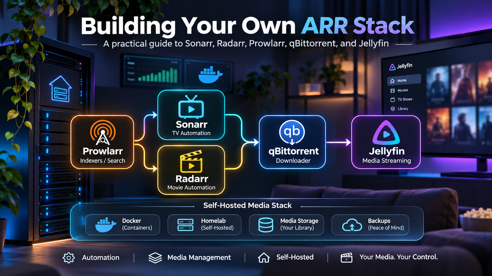
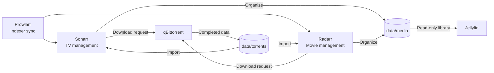

# ARR Stack — Docker Compose Installation & Operations Guide



[](https://docs.docker.com/compose/)
[](https://wiki.servarr.com/)
[](https://jellyfin.org/)

**Deploy five self-hosted media applications with a single Compose project:** Prowlarr (indexers), Sonarr (TV), Radarr (movies), qBittorrent (downloads), and Jellyfin (streaming).

> **Companion article:** [Building Your Own ARR Stack: A Complete Guide to Automated Media Management](https://www.linkedin.com/pulse/building-your-own-arr-stack-complete-guide-automated-wijethilaka-hiinc)
>
> This README is the **command-first companion** to the article. It is a reproducible *new installation* example, not a migration script for an existing server.

**Use only media and sources you are authorized to access.** No indexers or copyrighted media are bundled with this repository.

## Contents

1. [Architecture](#architecture)
2. [Requirements](#requirements)
3. [Directory and mount design](#directory-and-mount-design)
4. [Quick installation](#quick-installation)
5. [Application configuration](#application-configuration)
6. [End-to-end acceptance test](#end-to-end-acceptance-test)
7. [Diagnostics and troubleshooting](#diagnostics-and-troubleshooting)
8. [Operations: updates, backups, and recovery](#operations-updates-backups-and-recovery)
9. [Security notes](#security-notes)
10. [Documentation](#documentation)

## Architecture



| Service | Internal address on Compose network | Host web port | Role |
|---|---|---:|---|
| Prowlarr | `http://prowlarr:9696` | 9696 | Indexer management and app synchronization |
| Sonarr | `http://sonarr:8989` | 8989 | TV monitoring and completed-download import |
| Radarr | `http://radarr:7878` | 7878 | Movie monitoring and completed-download import |
| qBittorrent | `http://qbittorrent:8080` | 8080 | Torrent downloading |
| Jellyfin | `http://jellyfin:8096` | 8096 | Personal media streaming |

The `arr-net` bridge network is **created and managed by Docker Compose**. Containers resolve service names via Docker's embedded DNS. Do **not** use `localhost` for inter-container connections; inside a container, `localhost` means that same container.

## Requirements

- Linux host (Ubuntu Server or another Docker-supported distribution).
- Docker Engine with the **Docker Compose v2 plugin** (`docker compose`, not legacy `docker-compose`).
- Terminal/SSH access and enough disk space for your media.
- A trusted LAN or an SSH tunnel for accessing admin UIs.
- A filesystem supporting ordinary Linux ownership; using one filesystem for downloads and libraries is recommended for hardlinks.

Verify prerequisites:

```bash
docker --version
docker compose version
id -u
id -g
```

If Docker is missing, follow the [official Linux installation instructions](https://docs.docker.com/engine/install/); for Ubuntu, use the [Ubuntu-specific installation guide](https://docs.docker.com/engine/install/ubuntu/). Avoid installing a second Docker daemon over an existing deployment.

> **Security:** Membership in the `docker` group provides effectively root-level privileges. Use `sudo docker ...` if you have not deliberately granted your user Docker access.

## Directory and mount design

```text
arr-stack/
├── README.md
├── compose.yaml
├── .env.example
├── .env                 # local only; NOT committed
├── .gitignore
├── config/              # local only; application secrets and databases
│   ├── prowlarr/
│   ├── sonarr/
│   ├── radarr/
│   ├── qbittorrent/
│   └── jellyfin/
└── data/                # local only; downloads and library
    ├── torrents/
    │   ├── tv/
    │   └── movies/
    └── media/
        ├── tv/
        └── movies/
```

Every importing/downloading application gets **the same `./data:/data` volume**. This is deliberate:

| Use | Path *inside* containers | Available in |
|---|---|---|
| TV downloads | `/data/torrents/tv` | qBittorrent + Sonarr |
| Movie downloads | `/data/torrents/movies` | qBittorrent + Radarr |
| TV library | `/data/media/tv` | Sonarr; `/media/tv` in Jellyfin |
| Movie library | `/data/media/movies` | Radarr; `/media/movies` in Jellyfin |

Why it matters:

- qBittorrent reports a completed file's actual path. Sonarr/Radarr must be able to read **that same path**.
- A single shared `/data` mount on a compatible filesystem supports hardlinks and efficient imports.
- A **remote path mapping** rewrites a string; it does not move media or fix missing bind mounts.
- Jellyfin only needs read access to the *organized library*. It never needs direct access to the torrent download directories.

**Storage warning:** `./data` means the directory beside `compose.yaml`, on whichever filesystem holds the project. If you want a larger disk or NAS, deliberately replace `./data` with a **generic, existing mounted host path** in the three `volumes:` entries. Verify that mount before `docker compose up -d`; an absent disk can otherwise cause files to be written into the wrong filesystem. Cross-filesystem imports require copying, not hardlinking.

## Quick installation

### 1. Get the project files

Place `README.md`, `compose.yaml`, `.env.example`, and `.gitignore` in one directory. If using the ZIP linked with this guide, extract it first. For example:

```bash
mkdir -p ~/arr-stack
cd ~/arr-stack
# Copy the repository's compose.yaml and .env.example into this directory.
```

For a Git repository, you can also clone your own copy once you've published it (replace `<YOUR-REPOSITORY-URL>` with the actual URL):

```bash
git clone <YOUR-REPOSITORY-URL> arr-stack
cd arr-stack
```

### 2. Create folders and environment settings

```bash
mkdir -p config/{prowlarr,sonarr,radarr,qbittorrent,jellyfin}
mkdir -p data/torrents/{tv,movies} data/media/{tv,movies}

cp .env.example .env
sed -i "s/^PUID=.*/PUID=$(id -u)/" .env
sed -i "s/^PGID=.*/PGID=$(id -g)/" .env
chmod 600 .env
```

Edit `.env`:

```bash
nano .env
```

Example values:

```dotenv
PUID=1000
PGID=1000
TZ=Etc/UTC
WEB_BIND_IP=127.0.0.1
BT_BIND_IP=0.0.0.0
BT_PORT=6881
```

- `PUID`, `PGID`: the Linux account allowed to manage the folders.
- `TZ`: your IANA timezone, such as `Etc/UTC`.
- `WEB_BIND_IP`: **localhost-only** by default. To open web interfaces to your *trusted LAN*, replace with the host's real LAN IP and review firewall rules.
- `BT_BIND_IP`/`BT_PORT`: host bind address and listening port for BitTorrent peers; independent from the admin Web UI.

You can inspect candidate LAN IPs with `hostname -I`, but select the correct interface yourself if the host has multiple networks.

> `WEB_BIND_IP=0.0.0.0` publishes every web administration interface on every host interface. Avoid doing that on an internet-reachable host.

### 3. Check ownership and filesystem readiness

```bash
# Safe on a fresh installation; avoid recursive ownership changes on existing media.
chown -R "$(id -u):$(id -g)" config data

df -h .
stat -c '%u:%g %a %n' config data data/torrents data/media
```

If the host directories are on a separately mounted filesystem, check that mount **before** starting containers (`findmnt` / `df -h`).

### 4. Validate and start

```bash
docker compose config --quiet
docker compose pull
docker compose up -d
docker compose ps
```

View logs:

```bash
docker compose logs --tail=50 prowlarr sonarr radarr qbittorrent jellyfin
```

The application UIs are available at `http://<WEB_BIND_IP>:PORT` when bound to a LAN address. If bound to `127.0.0.1`, access them on the Docker host or use an SSH tunnel.

**SSH tunnel example** (run from your own computer):

```bash
ssh -N \
  -L 9696:127.0.0.1:9696 \
  -L 8989:127.0.0.1:8989 \
  -L 7878:127.0.0.1:7878 \
  -L 8080:127.0.0.1:8080 \
  -L 8096:127.0.0.1:8096 \
  your-user@your-server
```

Then visit `http://127.0.0.1:9696`, `:8989`, `:7878`, `:8080`, or `:8096` on your computer.

## Application configuration

Configure in this order: **qBittorrent → Sonarr/Radarr → Prowlarr → Jellyfin**.

### 1. qBittorrent (`:8080`)

Get the first-login password from startup logs:

```bash
docker compose logs qbittorrent --tail=100
```

Sign in as `admin` using the temporary password shown in the log, then immediately set a new Web UI password.

In **Tools → Options → Downloads**, configure the default download destination as `/data/torrents` and review **Saving Management**. For category-based paths, Automatic Torrent Management is recommended. Leave incomplete-download relocation disabled until you have a deliberate setup for it.

Create **two categories** in qBittorrent:

| Category | Absolute save path |
|---|---|
| `sonarr` | `/data/torrents/tv` |
| `radarr` | `/data/torrents/movies` |

For every torrent, check its **actual Save path** in the General tab. A category can be correct while a previously added torrent still uses an older path. Use qBittorrent's **Set Location** to relocate tracked torrents; do not manually move active torrent files.

**Port distinction:** other containers connect to `qbittorrent:8080` even if you later change the *host* Web UI port mapping.

### 2. Sonarr (`:8989`)

1. Complete initial setup and turn on authentication.
2. **Settings → Media Management → Root Folders:** add `/data/media/tv`.
3. Set episode naming, season folders, and a quality profile appropriate to your storage and playback clients.
4. **Settings → Download Clients → Add → qBittorrent**:

| Field | Value |
|---|---|
| Host | `qbittorrent` |
| Port | `8080` |
| Username / Password | Your qBittorrent Web UI credentials |
| Category | `sonarr` |

5. **Test → Save**. Keep **Completed Download Handling** enabled.

### 3. Radarr (`:7878`)

1. Complete initial setup and configure authentication.
2. **Settings → Media Management → Root Folders:** add `/data/media/movies`.
3. Configure preferred quality profile and naming rules.
4. **Settings → Download Clients → Add → qBittorrent**:

| Field | Value |
|---|---|
| Host | `qbittorrent` |
| Port | `8080` |
| Username / Password | Your qBittorrent Web UI credentials |
| Category | `radarr` |

5. **Test → Save**. Keep **Completed Download Handling** enabled.

> **Torrent seeding is normal:** after an import, qBittorrent may keep seeding the source files. The imported file should already be present in the organized library; don't assume a torrent remaining in qBittorrent means import failed.

### 4. Prowlarr (`:9696`)

1. Complete initial setup and authentication.
2. **Indexers → Add Indexer:** configure only indexers that you are permitted to use. Test each indexer.
3. Locate the Sonarr and Radarr API keys under each application's **Settings → General**.
4. **Prowlarr → Settings → Apps → Add Application**:

| Application | Prowlarr Server URL | Application Server URL | API key source |
|---|---|---|---|
| Sonarr | `http://prowlarr:9696` | `http://sonarr:8989` | Sonarr |
| Radarr | `http://prowlarr:9696` | `http://radarr:7878` | Radarr |

5. Test each connection, choose a sync level (**Full Sync** or **Add and Remove Only**), save, and run **Sync App Indexers**.
6. Verify corresponding indexers appear in **Sonarr/Radarr → Settings → Indexers**.

**Seeder selection:** Prowlarr's app sync profiles support **Minimum Seeders**. A threshold such as 5–10 can filter out releases with very low reported availability; older or niche content may need a lower threshold. This is **not** a guaranteed speed predictor, nor does it force Sonarr/Radarr to pick the release with the largest seeder count. Quality and release rules still matter. Use **Interactive Search** to review results manually.

**Do not needlessly configure Prowlarr as the download client in Sonarr/Radarr.** Prowlarr provides indexers; Sonarr/Radarr send downloads to qBittorrent themselves.

### 5. Jellyfin (`:8096`)

Complete the first-run wizard, choose credentials, and add libraries:

| Jellyfin library type | Container path |
|---|---|
| TV Shows | `/media/tv` |
| Movies | `/media/movies` |

Jellyfin's bind mount is **read-only** in this example. Its configuration/database remains writable under `/config`. If you want metadata or artwork written next to media files, you must explicitly reconsider the `:ro` mount and associated permissions.

Jellyfin detects organized files via scans; refresh a library after your first import. Hardware transcoding is **not** configured in this minimal stack and requires hardware-specific device mapping.

## End-to-end acceptance test

Use a small media file that you own or have permission to download.

- [ ] Prowlarr can test and sync an authorized indexer to Sonarr/Radarr.
- [ ] Sonarr/Radarr can test their qBittorrent download-client connections.
- [ ] A TV test download has the `sonarr` category and saves to `/data/torrents/tv`.
- [ ] A movie test download has the `radarr` category and saves to `/data/torrents/movies`.
- [ ] Sonarr/Radarr Activity → Queue / History shows the completed import.
- [ ] Imported files appear under `/data/media/tv` or `/data/media/movies`.
- [ ] Jellyfin lists the imported media after a library scan.

Check the host folders without touching any files:

```bash
find data/torrents/tv -maxdepth 2 -type f | head
find data/torrents/movies -maxdepth 2 -type f | head
find data/media/tv -maxdepth 3 -type f | head
find data/media/movies -maxdepth 3 -type f | head
```

Check write access as the configured container users:

```bash
docker compose exec -T sonarr sh -c 'test -w /data/torrents/tv && test -w /data/media/tv && echo Sonarr-WRITABLE'
docker compose exec -T radarr sh -c 'test -w /data/torrents/movies && test -w /data/media/movies && echo Radarr-WRITABLE'
docker compose exec -T qbittorrent sh -c 'test -w /data/torrents/tv && test -w /data/torrents/movies && echo qBittorrent-WRITABLE'
```

## Diagnostics and troubleshooting

### Service health and Docker DNS

```bash
docker compose ps
docker compose logs --tail=100 sonarr
docker compose logs --tail=100 radarr
docker compose logs --tail=100 prowlarr
docker compose logs --tail=100 qbittorrent

docker compose exec -T sonarr getent hosts qbittorrent
docker compose exec -T prowlarr getent hosts sonarr
docker compose exec -T prowlarr getent hosts radarr
```

The DNS checks should return internal container IP addresses. Network creation/recreation is handled by Compose; **no manual `docker network connect` or network-keeper systemd service is required** for this deployment.

Inspect the Compose-managed network:

```bash
docker network ls
docker compose ps --format json
```

If DNS works but application testing fails, inspect the actual error: authentication failure (`401`/`403`), timeout, unsupported host header, incorrect internal port, and network failure require different fixes.

### Completed torrent stuck; no import

1. Verify qBittorrent **Category**: `sonarr` or `radarr`.
2. Verify **General → Save path**: `/data/torrents/tv` or `/data/torrents/movies`.
3. Check Sonarr/Radarr **Settings → Download Clients → Test** and **Completed Download Handling**.
4. Inspect **Activity → Queue** warning tooltip and **History**.
5. Confirm `/data` exists in both containers and that the importer has read/write permissions.
6. Check that the media is identifiable and that an equal/higher-quality episode isn't already in the library.

```bash
docker compose exec -T sonarr ls -la /data/torrents/tv
docker compose exec -T radarr ls -la /data/torrents/movies
docker compose exec -T qbittorrent ls -la /data/torrents

docker compose logs --since=30m sonarr | grep -Ei 'import|download|error|permission|path' | tail -60
docker compose logs --since=30m radarr | grep -Ei 'import|download|error|permission|path' | tail -60
```

**Do not blindly add remote path mappings.** With a shared `/data` mount, none should be necessary for the download directories shown here.

### Hardlinks versus copies

On a **single, compatible filesystem**, a torrent's original file and imported media can be hardlinked, occupying the underlying data only once. Across different filesystems, Sonarr/Radarr must copy the file when keeping the original. `df -h` and `findmnt` help reveal filesystem boundaries.

Example *non-destructive temporary hardlink test* (run from the project directory):

```bash
touch data/torrents/.arr-hardlink-test
if ln data/torrents/.arr-hardlink-test data/media/.arr-hardlink-test; then
  stat -c 'inode=%i links=%h %n' data/torrents/.arr-hardlink-test data/media/.arr-hardlink-test
  echo 'Hardlinks available across these two paths'
else
  echo 'Hardlink failed: check filesystem boundaries and permissions'
fi
rm -f data/torrents/.arr-hardlink-test data/media/.arr-hardlink-test
```

Only run this on your own fresh paths. Hardlink availability doesn't automatically mean hardlink importing is enabled or possible for every media operation.

### qBittorrent has 0 B/s despite a completed setup

Check seeds/peers and individual tracker errors; review port and rate limits, temporary network reachability, and storage I/O. Reported seed counts can be stale. More seeders often improve availability, but not necessarily speed. A Docker Web UI port is **not** the same as the BitTorrent peer port.

### Jellyfin shows no media

```bash
docker compose exec -T jellyfin ls -la /media/tv
docker compose exec -T jellyfin ls -la /media/movies
docker compose logs --tail=100 jellyfin
```

Confirm that the Jellyfin library paths are **`/media/tv`** and **`/media/movies`**, not Sonarr's `/data/media/...` paths.

## Operations: updates, backups, and recovery

### Common commands

```bash
docker compose ps                    # status
docker compose logs -f sonarr        # follow one service
docker compose restart prowlarr     # restart one service
docker compose pull                 # retrieve newer images
docker compose up -d                # recreate changed services
docker image prune                  # remove unused images (review impact)
```

Review release notes and back up before updates. For more reproducibility, pin tested image tags/digests rather than always relying on `latest`.

### Back up configs safely

For a **consistent offline backup** of app configuration (temporarily interrupts service):

```bash
mkdir -p backups
docker compose stop

tar -czf "backups/arr-config-$(date +%Y%m%d-%H%M%S).tar.gz" config compose.yaml .env.example

docker compose up -d
```

This excludes the media library and excludes your private `.env`. Back up `.env` separately using a secure method if you need its local settings. Store backups outside the server as well; a backup on the same disk is not sufficient against disk loss.

### Recovery on another host

1. Install Docker/Compose.
2. Restore `config/`, `compose.yaml`, `.env.example`, your private `.env`, and the media directories/mounts.
3. Match user/group ownership and verify your storage is mounted.
4. Run `docker compose config --quiet && docker compose up -d`.
5. Check the apps' root folders, download-client paths, network connections, and media library scan.

## Security notes

- Admin Web UIs bind to `127.0.0.1` unless `WEB_BIND_IP` is explicitly changed. This is intentional.
- Docker-published ports can bypass assumptions about host-firewall rules. Restrict access at the network and host levels; avoid internet-facing admin panels.
- The BitTorrent peer port is separately published on `BT_BIND_IP` (default `0.0.0.0`) **only to the host interfaces**; inbound access through the router still depends on NAT, firewall, and your network policy. If you do not want this host port open, set `BT_BIND_IP=127.0.0.1` (with reduced peer connectivity) or remove the peer port mappings after considering your use case.
- Enable authentication in Sonarr, Radarr, Prowlarr, qBittorrent, and Jellyfin. Rotate credentials if exposed.
- Do not put API keys, `.env`, `config/`, `data/`, media files, databases, or logs into public Git history. This repository's `.gitignore` excludes them.
- Never run indiscriminate `chmod -R 777` or delete entire data folders to work around an import problem.
- Keep Jellyfin's media mount read-only if you don't require it to modify media files.
- Only use indexers and content you are authorized to access. This repository contains no indexer accounts or bypass instructions.

## Documentation

- [LinkedIn article — Building Your Own ARR Stack](https://www.linkedin.com/pulse/building-your-own-arr-stack-complete-guide-automated-wijethilaka-hiinc)
- [Docker Compose documentation](https://docs.docker.com/compose/)
- [Docker Engine installation](https://docs.docker.com/engine/install/)
- [Servarr Docker Guide](https://wiki.servarr.com/docker-guide)
- [Sonarr documentation](https://wiki.servarr.com/sonarr)
- [Radarr documentation](https://wiki.servarr.com/radarr)
- [Prowlarr documentation](https://wiki.servarr.com/prowlarr)
- [LinuxServer.io qBittorrent image](https://docs.linuxserver.io/images/docker-qbittorrent/)
- [LinuxServer.io Jellyfin image](https://docs.linuxserver.io/images/docker-jellyfin/)
- [Jellyfin documentation](https://jellyfin.org/docs/)

---

**Summary:** Prowlarr provides indexer integration; Sonarr and Radarr manage the selection and imports; qBittorrent downloads; Jellyfin serves the organized media. Reliable Docker networking and consistent shared paths are the key to making the whole system work.
